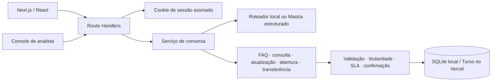

# Nexo Assist

Agente de atendimento de TI para a empresa fictícia Nexo. O funcionário conversa com o assistente, que consulta uma central de ajuda local, encontra e complementa chamados próprios, prepara novos chamados para confirmação e transfere casos a um analista. O projeto implementa os fluxos do desafio com persistência SQLite/libSQL e uma interface inspirada nos protótipos fornecidos.

**Demo publicada (Vercel + Turso):** [https://nexo-assist-tau.vercel.app](https://nexo-assist-tau.vercel.app)

## Funcionalidades

- Login de demonstração para funcionários e analistas, com cookie assinado e rotas separadas por perfil.
- Conversas persistidas, histórico por funcionário, limite de 30 mensagens por conversa e exclusão de conversas próprias que não estejam com o service desk.
- Consulta de oito artigos de FAQ incluídos no seed. O assistente só responde com conteúdo que encontrou na central.
- Consulta de chamados limitada ao titular autenticado, com status, prioridade, resumo e prazo.
- Complemento e reabertura dentro de sete dias apresentados como rascunho e gravados somente após confirmação.
- Abertura de chamado com coleta de descrição e abrangência, classificação de tipo/categoria/prioridade, verificação de duplicidade e confirmação obrigatória.
- Transferência para atendimento humano. A conversa fica aguardando, o agente para de responder e o resumo aparece na fila dos analistas.
- Console de analista com fila, filtros, busca, assumir, responder, devolver ao agente e encerrar atendimento.
- Transparência acima das respostas: intenção, ação, confiança, motivo e resultado da decisão.
- Interface responsiva para login, atendimento, consulta de perfil e console.

## Stack

- **Next.js 16 / React 19** para interface e Route Handlers HTTP.
- **TypeScript estrito** nos componentes, contratos e serviços.
- **SQLite/libSQL** para usuários, conversas, mensagens, chamados, eventos e FAQ. O modo local usa um arquivo SQLite; Vercel usa Turso/libSQL remoto para compartilhar estado persistente entre Functions.
- **Mastra + Ollama + Qwen3 4B** para classificar mensagens ambíguas localmente com saída estruturada. Não exige chave de API; as intenções claras continuam no roteador determinístico para responder sem esperar o modelo.
- **Node.js 22.6 ou superior** para desenvolvimento/testes com strip de tipos do Node. Em hospedagem Vercel, use Node.js 22.x ou 24.x.

### Por que usar Ollama junto com Mastra

O **Qwen3 4B é o modelo**, o **Ollama é o runtime que o instala e serve localmente**, e o **Mastra é o framework que integra o modelo ao agente**. As ferramentas têm papéis diferentes: o Ollama permite rodar a inferência no computador, enquanto o Mastra monta o contexto, solicita uma classificação estruturada e conecta essa resposta ao fluxo TypeScript. Essa combinação atende ao service desk porque mensagens potencialmente sensíveis não precisam ser enviadas a uma API de terceiros e não há cobrança por chamada. O custo é manter o serviço Ollama ativo e ter memória local suficiente; por isso, o agente usa o LLM somente quando o roteador determinístico não identifica a intenção com segurança.

O Mastra também mantém o código do agente desacoplado do runtime do modelo: a aplicação valida a saída com Zod e os serviços do backend continuam aplicando autorização e regras de negócio. Assim, trocar o modelo ou o provider não transfere ao LLM o controle sobre chamados, usuários ou permissões. O provider Ollama usado pelo Mastra é `ollama-ai-provider-v2`; consulte a [documentação do provider Ollama no Mastra](https://mastra.ai/models/providers/ollama), a [documentação do Ollama no AI SDK](https://ai-sdk.dev/providers/community-providers/ollama) e a [documentação do Mastra](https://mastra.ai/docs).

### Modelo escolhido

O **Qwen3 4B** foi escolhido para classificar mensagens que o roteador local não reconhece com segurança, priorizando menor uso de memória e resposta mais rápida no Mac Apple Silicon com 16 GB. A variante quantizada publicada no Ollama ocupa cerca de 2,5 GB. Solicitações claras continuam usando o roteador local; mensagens ambíguas seguem para o Mastra/Ollama, com pensamento estendido desativado, contexto limitado a 4.096 tokens, saída limitada a 128 tokens e timeout de 30 segundos. A primeira resposta pode demorar mais enquanto o modelo é carregado na memória. Consulte também a [página do Qwen3 4B no Ollama](https://ollama.com/library/qwen3:4b).

Com `NEXO_AGENT_MODE=mastra`, mensagens ambíguas são enviadas ao serviço Ollama local em `127.0.0.1:11434`; não há credencial externa e a inferência não depende da internet depois que o modelo foi baixado. O Ollama precisa estar instalado, ativo e com o modelo disponível.

O PRD permite simular o serviço externo de chamados, mas exige estado persistente. Por isso, o serviço de chamados é implementado no backend, e seus registros são gravados em SQLite/libSQL. Em desenvolvimento, o banco é um arquivo local; na Vercel, a aplicação exige `TURSO_DATABASE_URL` e `TURSO_AUTH_TOKEN` e falha de forma explícita sem eles, em vez de usar o filesystem efêmero da Function. A camada de agente apenas escolhe uma intenção; o backend valida titularidade, parâmetros e regras antes de qualquer operação. O roteador determinístico permanece disponível ao definir `NEXO_AGENT_MODE=local`.

## Arquitetura



### Decisão do agente

1. A API valida o cookie, perfil, conversa, texto e limite da sessão.
2. O roteador local escolhe imediatamente intenções claras para FAQ, consulta, complemento, abertura, transferência e assunto fora do escopo. Com `NEXO_AGENT_MODE=mastra`, mensagens ambíguas seguem para o Mastra e o Qwen3 via Ollama classifica em um esquema Zod; a saída ainda passa pelas mesmas regras de negócio. A chamada ao modelo é limitada a 30 segundos.
3. O serviço executável correspondente lê ou grava os dados do usuário autenticado. Ações de criação, atualização e reabertura geram um rascunho antes de gravar.
4. O resultado confirmado é persistido e exibido com o cartão e a trilha de decisão. Erros são convertidos em resposta controlada; o agente não afirma sucesso se a gravação não foi concluída.
5. Uma transferência muda o estado para `waiting` e pausa o agente. Um analista pode assumir, conversar com o funcionário, devolver a sessão ao agente ou encerrá-la.

| Ação | Regra principal |
| --- | --- |
| `buscar_central_de_ajuda` | Busca por título, conteúdo e palavras-chave; a resposta vem do artigo salvo. |
| `consultar_meus_chamados` / `consultar_chamado` | Lista ou lê somente chamados cujo titular é o usuário da sessão. |
| `complementar_chamado` / `reabrir_chamado` | Exige chamado próprio, rascunho e confirmação; reabertura só até sete dias após resolução. |
| `criar_chamado` | Exige descrição, tipo, categoria, prioridade, abrangência e confirmação. Uma duplicidade ativa é encaminhada como complemento. |
| `transferir_conversa` | Registra motivo e resumo, põe a conversa na fila e pausa a resposta automática. |

### Prioridade e SLA

| Prioridade | Critério operacional adotado | Prazo de resposta |
| --- | --- | --- |
| Crítica | Interrupção que afeta equipe ou empresa | 1 hora, com encaminhamento ao Suporte N2 |
| Alta | Funcionário sem conseguir trabalhar ou compromisso no mesmo dia | 4 horas úteis |
| Média | Impacto com alternativa de trabalho | 3 dias úteis |
| Baixa | Pedido não urgente | 5 dias úteis |

O horário útil é segunda a sexta, das 8h às 18h no fuso `APP_TIMEZONE`. O PRD não fornece calendário de feriados, então feriados não são descontados. A classificação por frases é deliberadamente simples no modo local; revise a decisão exibida antes de confirmar o chamado.

## Persistência e dados de demonstração

O schema versionado em `migrations/001_initial.sql` contém:

- `users`: funcionários e analistas de demonstração;
- `tickets`: titular, tipo, categoria, prioridade, status, abrangência, grupo e SLA;
- `conversations`: estado do agente/atendimento, rascunho e analista responsável;
- `messages`: histórico, cartões e trilha de decisão em JSON;
- `knowledge_articles`: artigos e palavras-chave da FAQ;
- `conversation_events`: criação, transferência, atualização, reabertura e ações do analista;
- `schema_migrations`: versão aplicada.

O seed é idempotente e inclui nove perfis, oito artigos, chamados em diferentes estados e uma conversa transferida visível no console. O arquivo padrão local é `data/nexo-assist.sqlite`, ignorado pelo Git. Na Vercel, Turso/libSQL fornece o banco remoto; as migrations e o seed inicial (quando a tabela `users` está vazia) são aplicados automaticamente na primeira conexão, além de poderem ser executados manualmente com `npm run db:seed`.

## Estrutura de pastas

```text
src/
  app/                 páginas Next e endpoints HTTP
  components/          interface reutilizável
  server/
    agent/             classificação local e adaptador Mastra
    auth/              sessão e usuário autenticado
    config/            carregamento de ambiente para scripts
    db/                SQLite, modelos e seed
    services/          conversa, SLA, FAQ, classificação e console
  shared/              contratos TypeScript compartilhados
migrations/            schema SQLite
scripts/               seed e reset do banco
tests/                 testes dos fluxos e regras de negócio
```

## Requisitos

- Node.js 22.6.0 ou superior e npm.
- [Ollama](https://ollama.com/download) instalado e em execução para inferência local via Mastra (`qwen3:4b`). Depois de baixar o modelo, a classificação local não precisa de chave de API nem de conexão com provedor externo.
- Para publicar na Vercel: Turso/libSQL conectado ao projeto (`TURSO_DATABASE_URL` e `TURSO_AUTH_TOKEN`). Sem um endpoint Ollama remoto configurado em `OLLAMA_BASE_URL`, a hospedagem serverless usa automaticamente o roteador determinístico em vez de tentar conectar a `127.0.0.1`.
- Não é necessário Docker: o desenvolvimento local usa SQLite no arquivo.

## Instalar e executar

```bash
cp .env.example .env
npm install
ollama pull qwen3:4b
npm run dev
```

O `.env.example` configura Mastra com `ollama/qwen3:4b`. Instale e abra o Ollama antes de iniciar a aplicação. No macOS, também é possível instalar o serviço com Homebrew (`brew install ollama`) e iniciá-lo em outro terminal com `ollama serve`; em seguida execute `ollama pull qwen3:4b`. O endpoint local padrão é `http://127.0.0.1:11434/api` e pode ser alterado em `OLLAMA_BASE_URL`. O script `predev` inicializa o schema e carrega o seed antes de iniciar o Next.js em `http://localhost:3000`. O carregamento do seed pode ser repetido sem duplicar os dados. Sem o serviço local, os fluxos determinísticos claros continuam disponíveis, mas mensagens ambíguas que dependem do LLM retornam um erro controlado.

### Contas de demonstração

| Perfil | E-mail | Senha |
| --- | --- | --- |
| Funcionária Ana Souza | `ana.souza@nexo.com.br` | Qualquer valor não vazio |
| Analista Rafael Lima | `rafael.lima@nexo.com.br` | Qualquer valor não vazio |

O PRD especifica que a demonstração aceita qualquer senha. Essa autenticação é apenas para avaliação local e não deve ser usada em produção. A solicitação de redefinição de senha não envia e-mail; a tela de perfil deixa essa limitação explícita.

## Variáveis de ambiente

| Variável | Padrão | Uso |
| --- | --- | --- |
| `NEXO_AGENT_MODE` | `mastra` no `.env.example` | `mastra` usa o modelo configurado no Ollama; `local` desativa chamadas ao LLM. |
| `NEXO_LLM_MODEL` | `ollama/qwen3:4b` | Provider e modelo usados pelo Mastra; o prefixo deve ser `ollama/`. |
| `OLLAMA_BASE_URL` | `http://127.0.0.1:11434/api` | URL base da API local do Ollama. Para Ollama Cloud, use `https://ollama.com/api`. |
| `OLLAMA_API_KEY` | vazio | Opcional localmente; obrigatório para API direta do Ollama Cloud. Enviado no header Bearer, somente no backend. |
| `SESSION_SECRET` | segredo local de demonstração | Em produção, defina valor aleatório com pelo menos 32 caracteres. |
| `DB_PATH` | `./data/nexo-assist.sqlite` | Nome relativo dentro de `data/` ou caminho absoluto; `:memory:` é usado nos testes. |
| `TURSO_DATABASE_URL` | vazio | URL do banco remoto libSQL; quando presente, substitui SQLite local. Obrigatória na Vercel. |
| `TURSO_AUTH_TOKEN` | vazio | Credencial Turso; obrigatória com `TURSO_DATABASE_URL`. |
| `APP_TIMEZONE` | `America/Bahia` | Fuso dos horários úteis e da apresentação do SLA. |

`.env.example` contém somente valores de exemplo e é seguro para commit. Nunca publique `.env`, tokens ou chaves reais.

O `.env.example` seleciona `ollama/qwen3:4b` e o modo Mastra. Não há chave a configurar. Se o Ollama estiver desligado, o modelo não tiver sido baixado ou a geração exceder 30 segundos, o chat informa que a classificação não foi concluída; não afirma que usou o LLM nem executa uma ação baseada em uma resposta inexistente. O backend continua responsável pelas decisões de acesso e execução.

Para avaliar a integração de agente/LLM do PRD, mantenha `NEXO_AGENT_MODE=mastra`, inicie o Ollama e confirme que `ollama list` mostra `qwen3:4b`. A primeira mensagem ambígua após o serviço iniciar pode levar mais tempo durante o carregamento do modelo; mensagens com intenção clara continuam passando pelo roteador local.

## Banco de dados

```bash
npm run db:seed   # aplica a migration e carrega os dados sem duplicar
npm run db:reset  # apaga o arquivo SQLite local e recria a demonstração
```

`db:reset` remove o banco SQLite local (incluindo arquivos auxiliares) e repõe o seed. Ele se recusa a rodar com `TURSO_DATABASE_URL` configurado para evitar reset remoto acidental. `npm run db:seed` pode inicializar o banco Turso de forma idempotente.

## Verificações

```bash
npm test          # testes dos serviços, persistência, segurança e SLA
npm run test:api  # build antes; inicia o servidor de produção e verifica páginas e rotas HTTP
npm run typecheck # TypeScript estrito
npm run lint      # ESLint / regras Next
npm run build     # build de produção Next.js
```

Para executar a versão de produção depois do build:

```bash
npm start
```

`prestart` carrega o seed de forma idempotente antes de iniciar o servidor. Os testes dos serviços usam SQLite em memória, salvo o caso que valida persistência entre fechar e reabrir um arquivo temporário. `test:api` requer um build existente e verifica login, HTML das páginas, permissão por perfil, FAQ, chamados, ações do console e limpeza do cookie de sessão no logout por HTTP.

## Conversas para avaliar

### Dúvida da FAQ

> Como resolvo o erro 809 da VPN no Windows 10?

O assistente retorna o procedimento do artigo. Se a pessoa informar Windows 11, o artigo diz que não se aplica e recomenda abrir um chamado para diagnóstico.

### Consultar chamado

> Qual o status do meu chamado?

O sistema lista os chamados abertos da conta. Se houver mais de um, escolha um cartão para ver detalhes e prazo. Tente `INC-20460` como Ana para validar o bloqueio de dados de outro titular.

### Complementar ou reabrir

> Quero complementar INC-20311: reiniciei e a lentidão continua.

Confira o rascunho e confirme para salvar. O seed também inclui `INC-20150`, resolvido há menos de sete dias, para validar a reabertura após confirmação.

### Abrir chamado

> Preciso abrir um chamado
>
> Meu notebook não conecta na VPN e mostra erro 809 no Windows 11. Tenho reunião com cliente hoje.
>
> Só eu

Confira descrição, categoria, prioridade e abrangência e selecione **Confirmar**. Nada é criado antes dessa confirmação.

### Escalar para analista

> Quero falar com um analista sobre o INC-20311

A conversa aparece no console de Rafael, com resumo e chamado relacionado. O roteador automático fica pausado até o analista assumir ou devolver a conversa.

## Critérios atendidos e decisões

O checklist de rastreabilidade está em [`docs/requirements-checklist.md`](docs/requirements-checklist.md).

- FAQ, consulta, complemento, reabertura, criação, confirmação e transferência têm operações correspondentes persistidas.
- O acesso de funcionário a chamados é filtrado pelo titular em consultas e validações de alteração.
- Erros de entrada, permissões, janela de reabertura, sessão pausada e falhas de serviço retornam estados controlados.
- A arquitetura mantém roteamento de intenção separado das regras que alteram dados. A decisão do LLM nunca concede autorização.
- Foi adotado o SQLite local porque o PRD admite serviço de tickets simulado e pede execução simples e estado persistente.
- Foi adotado horário útil sem feriados porque o PRD não define calendário de feriados nem localidade de operação além do horário de atendimento.

## Limitações conhecidas

- **Login de demonstração (requisito do PRD):** o PRD determina que qualquer senha não vazia seja aceita nas contas de demonstração. Atende ao desafio, mas não substitui autenticação corporativa; não use esse modo para dados reais.
- **ITSM simulado (permitido pelo PRD):** não há integração com ServiceNow, Jira Service Management ou outro ITSM. O PRD permite simular esse serviço, e as operações do desafio são executadas e persistidas no banco SQLite/Turso.
- **Hospedagem do modelo:** localmente, Ollama e `qwen3:4b` rodam na máquina que executa o backend. Na Vercel, caso nenhum endpoint Ollama remoto seja configurado em `OLLAMA_BASE_URL`, a aplicação recua automaticamente para o roteador determinístico (exibindo `Roteador local` na interface) em vez de tentar conectar em `127.0.0.1`; ao configurar um endpoint Ollama remoto acessível, o modo `Mastra · Ollama` assume automaticamente.
- **Sincronização do console:** a fila de analistas atualiza por polling inteligente (pausado quando a aba está oculta ou há envio em andamento), compartilhando estado entre instâncias via Turso; não há WebSocket ou atribuição automática de carga.
- **E-mail externo:** redefinição de senha, privacidade e contato de suporte exibem avisos orientativos na própria interface, pois não há provedor SMTP no escopo do desafio.
- **Calendário de feriados:** o SLA desconta fins de semana e horário fora de 8h–18h, mas não feriados porque o PRD não fornece calendário oficial.
- **Proteção e escopo do deploy de avaliação:** a publicação conta com banco gerenciado (Turso/libSQL), `SESSION_SECRET` forte obrigatório em produção, validação de origem (`Origin`/`Host`) contra CSRF, cabeçalhos HTTP de segurança e rate limiting nas rotas de mutação/login (`429 Too Many Requests`). Ainda assim, mantém as contas abertas de demonstração exigidas pelo PRD — não insira informações pessoais reais.

## Deploy na Vercel

O modo local não pode ser publicado sem ajustes: as Functions da Vercel não têm filesystem persistente e não conseguem acessar o Ollama em `localhost`. A aplicação usa Turso/libSQL como banco remoto e aceita um endpoint Ollama remoto; no desenvolvimento, SQLite local e Ollama local continuam sendo os padrões.

1. Importe o repositório GitHub na Vercel ou vincule-o com `vercel link`.
2. Conecte a integração [Turso Cloud](https://vercel.com/marketplace/tursocloud/database) ao projeto. Ela fornece `TURSO_DATABASE_URL` e `TURSO_AUTH_TOKEN`. Confira o plano e a cobrança apresentados no Marketplace antes de habilitar o recurso.
3. Configure nos ambientes Preview e Production: `SESSION_SECRET` com valor aleatório forte; `NEXO_AGENT_MODE=mastra`; `NEXO_LLM_MODEL=ollama/<modelo-disponível-no-endpoint>`; `OLLAMA_BASE_URL=https://ollama.com/api`; e `OLLAMA_API_KEY` com uma chave do Ollama Cloud. Também pode apontar para outra instalação Ollama compatível e acessível pela Function. Nunca use prefixo `NEXT_PUBLIC_` para esses segredos.
4. Puxe as variáveis de Preview na máquina de avaliação e rode o seed remoto uma vez:

   ```bash
   vercel env pull .env.local
   npm run db:seed
   ```

   A API do Ollama Cloud requer chave e nome de modelo disponível no endpoint. `qwen3:4b` continua como padrão de desenvolvimento local; escolha o identificador do modelo hospedado em `NEXO_LLM_MODEL` para publicação.

5. Faça o deploy de produção:

   ```bash
   vercel deploy --prod
   ```

O endpoint `/api/chat` permite até 60 segundos para a classificação. Não configure `OLLAMA_BASE_URL=http://127.0.0.1:11434/api` na Vercel. O banco e as chaves precisam estar disponíveis também no ambiente Preview se ele for usado para avaliação.
