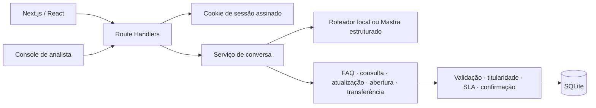

# Nexo Assist

Agente de atendimento de TI para a empresa fictícia Nexo. O funcionário conversa com o assistente, que consulta uma central de ajuda local, encontra e complementa chamados próprios, prepara novos chamados para confirmação e transfere casos a um analista. O projeto implementa os fluxos do desafio com persistência SQLite e uma interface inspirada nos protótipos fornecidos.

## Funcionalidades

- Login de demonstração para funcionários e analistas, com cookie assinado e rotas separadas por perfil.
- Conversas persistidas, histórico por funcionário, limite de 30 mensagens por conversa e exclusão de conversas próprias que não estejam com o service desk.
- Consulta de oito artigos de FAQ incluídos no seed. O assistente só responde com conteúdo que encontrou na central.
- Consulta de chamados limitada ao titular autenticado, com status, prioridade, resumo e prazo.
- Complemento e reabertura dentro de sete dias apresentados como rascunho e gravados somente após confirmação.
- Abertura de chamado com coleta de descrição e abrangência, classificação de tipo/categoria/prioridade, verificação de duplicidade e confirmação obrigatória.
- Transferência para atendimento humano. A conversa fica aguardando, o agente para de responder e o resumo aparece na fila dos analistas.
- Console de analista com fila, filtros, busca, assumir, responder, devolver ao agente e encerrar atendimento.
- Transparência acima das respostas: intenção, ação, confiança, motivo e resultado da decisão.
- Interface responsiva para login, atendimento, consulta de perfil e console.

## Stack

- **Next.js 16 / React 19** para interface e Route Handlers HTTP.
- **TypeScript estrito** nos componentes, contratos e serviços.
- **SQLite (`node:sqlite`)** para usuários, conversas, mensagens, chamados, eventos e FAQ; sem serviço externo para a demonstração.
- **Mastra + OpenAI GPT-6.1 Sol** para classificar mensagens ambíguas com saída estruturada quando há chave de API. Sem credencial, o roteador determinístico local mantém a demonstração funcional e rápida.
- **Node.js 22.22 ou superior**. `node:sqlite` e o strip de tipos do Node ainda são recursos experimentais nessa versão; o projeto não usa banco em memória na execução normal.

### Motivo da escolha do modelo e do framework

O **GPT-6.1 Sol** foi escolhido para classificar mensagens que o roteador local não reconhece com segurança. O modelo retorna uma decisão estruturada; o Mastra integra a chamada ao agente TypeScript e um schema Zod valida os campos. O backend continua responsável por autorização e operações, sem deixar o modelo alterar dados diretamente. Consulte a [documentação do GPT-6.1 Sol](https://developers.openai.com/api/docs/models/gpt-6.1-sol) e a [documentação do Mastra](https://mastra.ai/docs).

O Next.js roda localmente, mas o modelo GPT **não** roda no computador: quando `OPENAI_API_KEY` está configurada e `NEXO_AGENT_MODE=mastra`, a classificação é enviada à API da OpenAI e depende de internet e da cota da conta. Sem a chave, a aplicação usa o roteador determinístico local, sem chamar um LLM. Solicitações claras também passam pelo roteador local para evitar latência desnecessária; mensagens ambíguas usam Mastra/GPT. Chamadas ao provedor têm limite de 15 segundos.

O PRD permite simular o serviço externo de chamados, mas exige estado persistente. Por isso, o serviço de chamados é implementado no backend local, e seus registros são gravados em SQLite. A camada de agente apenas escolhe uma intenção; o backend valida titularidade, parâmetros e regras antes de qualquer operação. O modo Mastra usa o modelo escolhido quando há uma chave; o modo local fica claramente identificado quando não há credencial.

## Arquitetura



### Decisão do agente

1. A API valida o cookie, perfil, conversa, texto e limite da sessão.
2. O roteador local escolhe imediatamente intenções claras para FAQ, consulta, complemento, abertura, transferência e assunto fora do escopo. Com `NEXO_AGENT_MODE=mastra` e `OPENAI_API_KEY` configurada, mensagens ambíguas seguem para o Mastra e o GPT classifica em um esquema Zod; a saída ainda passa pelas mesmas regras de negócio. A chamada ao provedor é limitada a 15 segundos.
3. O serviço executável correspondente lê ou grava os dados do usuário autenticado. Ações de criação, atualização e reabertura geram um rascunho antes de gravar.
4. O resultado confirmado é persistido e exibido com o cartão e a trilha de decisão. Erros são convertidos em resposta controlada; o agente não afirma sucesso se a gravação não foi concluída.
5. Uma transferência muda o estado para `waiting` e pausa o agente. Um analista pode assumir, conversar com o funcionário, devolver a sessão ao agente ou encerrá-la.

| Ação | Regra principal |
| --- | --- |
| `buscar_central_de_ajuda` | Busca por título, conteúdo e palavras-chave; a resposta vem do artigo salvo. |
| `consultar_meus_chamados` / `consultar_chamado` | Lista ou lê somente chamados cujo titular é o usuário da sessão. |
| `complementar_chamado` / `reabrir_chamado` | Exige chamado próprio, rascunho e confirmação; reabertura só até sete dias após resolução. |
| `criar_chamado` | Exige descrição, tipo, categoria, prioridade, abrangência e confirmação. Uma duplicidade ativa é encaminhada como complemento. |
| `transferir_conversa` | Registra motivo e resumo, põe a conversa na fila e pausa a resposta automática. |

### Prioridade e SLA

| Prioridade | Critério operacional adotado | Prazo de resposta |
| --- | --- | --- |
| Crítica | Interrupção que afeta equipe ou empresa | 1 hora, com encaminhamento ao Suporte N2 |
| Alta | Funcionário sem conseguir trabalhar ou compromisso no mesmo dia | 4 horas úteis |
| Média | Impacto com alternativa de trabalho | 3 dias úteis |
| Baixa | Pedido não urgente | 5 dias úteis |

O horário útil é segunda a sexta, das 8h às 18h no fuso `APP_TIMEZONE`. O PRD não fornece calendário de feriados, então feriados não são descontados. A classificação por frases é deliberadamente simples no modo local; revise a decisão exibida antes de confirmar o chamado.

## Persistência e dados de demonstração

O schema versionado em `migrations/001_initial.sql` contém:

- `users`: funcionários e analistas de demonstração;
- `tickets`: titular, tipo, categoria, prioridade, status, abrangência, grupo e SLA;
- `conversations`: estado do agente/atendimento, rascunho e analista responsável;
- `messages`: histórico, cartões e trilha de decisão em JSON;
- `knowledge_articles`: artigos e palavras-chave da FAQ;
- `conversation_events`: criação, transferência, atualização, reabertura e ações do analista;
- `schema_migrations`: versão aplicada.

O seed é idempotente e inclui nove perfis, oito artigos, chamados em diferentes estados e uma conversa transferida visível no console. O arquivo padrão é `data/nexo-assist.sqlite`, ignorado pelo Git.

## Estrutura de pastas

```text
src/
  app/                 páginas Next e endpoints HTTP
  components/          interface reutilizável
  server/
    agent/             classificação local e adaptador Mastra
    auth/              sessão e usuário autenticado
    config/            carregamento de ambiente para scripts
    db/                SQLite, modelos e seed
    services/          conversa, SLA, FAQ, classificação e console
  shared/              contratos TypeScript compartilhados
migrations/            schema SQLite
scripts/               seed e reset do banco
tests/                 testes dos fluxos e regras de negócio
```

## Requisitos

- Node.js 22.22.0 ou superior e npm.
- `OPENAI_API_KEY` é necessária para chamadas ao GPT pela API da OpenAI. Sem ela, o app usa o roteador local; chamadas GPT têm cobrança e limites definidos pela conta OpenAI.
- Não é necessário Docker: a demonstração usa SQLite local.

## Instalar e executar

```bash
cp .env.example .env
npm install
npm run dev
```

O `.env.example` já configura Mastra com `openai/gpt-6.1-sol`. Para habilitar chamadas reais ao GPT, preencha `OPENAI_API_KEY` no `.env` com uma chave da [plataforma OpenAI](https://platform.openai.com/api-keys). O script `predev` inicializa o schema e carrega o seed antes de iniciar o Next.js em `http://localhost:3000`. Sem a chave, a interface indica “Assistente local online” e usa o roteador local. O carregamento do seed pode ser repetido sem duplicar os dados.

### Contas de demonstração

| Perfil | E-mail | Senha |
| --- | --- | --- |
| Funcionária Ana Souza | `ana.souza@nexo.com.br` | Qualquer valor não vazio |
| Analista Rafael Lima | `rafael.lima@nexo.com.br` | Qualquer valor não vazio |

O PRD especifica que a demonstração aceita qualquer senha. Essa autenticação é apenas para avaliação local e não deve ser usada em produção. A solicitação de redefinição de senha não envia e-mail; a tela de perfil deixa essa limitação explícita.

## Variáveis de ambiente

| Variável | Padrão | Uso |
| --- | --- | --- |
| `OPENAI_API_KEY` | vazio | Chave para chamadas reais ao GPT pela API da OpenAI. |
| `NEXO_AGENT_MODE` | `mastra` no `.env.example` | `mastra` ou `local`; sem chave, o app identifica e usa o roteador local. |
| `NEXO_LLM_MODEL` | `openai/gpt-6.1-sol` | Modelo de classificação configurável para Mastra. |
| `SESSION_SECRET` | segredo local de demonstração | Em produção, defina valor aleatório com pelo menos 32 caracteres. |
| `DB_PATH` | `./data/nexo-assist.sqlite` | Nome relativo dentro de `data/` ou caminho absoluto; `:memory:` é usado nos testes. |
| `APP_TIMEZONE` | `America/Bahia` | Fuso dos horários úteis e da apresentação do SLA. |

`.env.example` contém somente valores de exemplo e é seguro para commit. Nunca publique `.env`, tokens ou chaves reais.

O `.env.example` seleciona `openai/gpt-6.1-sol` e o modo Mastra. Configure sua própria `OPENAI_API_KEY` no `.env` e reinicie a aplicação para habilitar chamadas reais. Sem chave, a aplicação mostra “Assistente local online” e não chama um LLM. Se a API falhar ou exceder 15 segundos, o chat informa que a classificação não foi concluída; não declara que o GPT foi usado nem executa uma ação baseada em uma resposta inexistente. O backend continua responsável pelas decisões de acesso e execução.

Para a avaliação do requisito de agente/LLM do PRD, execute com uma chave OpenAI válida e `NEXO_AGENT_MODE=mastra`. O modo local permite explorar os fluxos sem credenciais, mas não substitui uma chamada real ao GPT quando a integração LLM for avaliada.

## Banco de dados

```bash
npm run db:seed   # aplica a migration e carrega os dados sem duplicar
npm run db:reset  # apaga o arquivo SQLite local e recria a demonstração
```

`db:reset` remove o banco configurado em `DB_PATH` (incluindo arquivos WAL/SHM) e repõe o seed. Use-o somente quando quiser restaurar o estado de demonstração.

## Verificações

```bash
npm test          # testes dos serviços, persistência, segurança e SLA
npm run test:api  # build antes; inicia o servidor de produção e verifica páginas e rotas HTTP
npm run typecheck # TypeScript estrito
npm run lint      # ESLint / regras Next
npm run build     # build de produção Next.js
```

Para executar a versão de produção depois do build:

```bash
npm start
```

`prestart` carrega o seed de forma idempotente antes de iniciar o servidor. Os testes dos serviços usam SQLite em memória, salvo o caso que valida persistência entre fechar e reabrir um arquivo temporário. `test:api` requer um build existente e verifica login, HTML das páginas, permissão por perfil, FAQ, chamados, ações do console e limpeza do cookie de sessão no logout por HTTP.

## Conversas para avaliar

### Dúvida da FAQ

> Como resolvo o erro 809 da VPN no Windows 10?

O assistente retorna o procedimento do artigo. Se a pessoa informar Windows 11, o artigo diz que não se aplica e recomenda abrir um chamado para diagnóstico.

### Consultar chamado

> Qual o status do meu chamado?

O sistema lista os chamados abertos da conta. Se houver mais de um, escolha um cartão para ver detalhes e prazo. Tente `INC-20460` como Ana para validar o bloqueio de dados de outro titular.

### Complementar ou reabrir

> Quero complementar INC-20311: reiniciei e a lentidão continua.

Confira o rascunho e confirme para salvar. O seed também inclui `INC-20150`, resolvido há menos de sete dias, para validar a reabertura após confirmação.

### Abrir chamado

> Preciso abrir um chamado
>
> Meu notebook não conecta na VPN e mostra erro 809 no Windows 11. Tenho reunião com cliente hoje.
>
> Só eu

Confira descrição, categoria, prioridade e abrangência e selecione **Confirmar**. Nada é criado antes dessa confirmação.

### Escalar para analista

> Quero falar com um analista sobre o INC-20311

A conversa aparece no console de Rafael, com resumo e chamado relacionado. O roteador automático fica pausado até o analista assumir ou devolver a conversa.

## Critérios atendidos e decisões

O checklist de rastreabilidade está em [`docs/requirements-checklist.md`](docs/requirements-checklist.md).

- FAQ, consulta, complemento, reabertura, criação, confirmação e transferência têm operações correspondentes persistidas.
- O acesso de funcionário a chamados é filtrado pelo titular em consultas e validações de alteração.
- Erros de entrada, permissões, janela de reabertura, sessão pausada e falhas de serviço retornam estados controlados.
- A arquitetura mantém roteamento de intenção separado das regras que alteram dados. A decisão do LLM nunca concede autorização.
- Foi adotado o SQLite local porque o PRD admite serviço de tickets simulado e pede execução simples e estado persistente.
- Foi adotado horário útil sem feriados porque o PRD não define calendário de feriados nem localidade de operação além do horário de atendimento.

## Limitações conhecidas

- Login e senha são de demonstração, sem diretório corporativo ou senha real.
- O provedor de chamados é local; não há integração com ServiceNow, Jira Service Management ou outro ITSM.
- Sem `OPENAI_API_KEY`, a classificação local usa regras e similaridade lexical; casos ambíguos podem exigir esclarecimento. Para demonstrar o LLM, configure uma chave de API da OpenAI.
- A fila de analistas é uma demonstração local com atualização por polling; não há WebSocket, presença real ou distribuição de carga entre instâncias.
- Redefinição de senha, privacidade e e-mail de suporte não têm integração de envio externo.
- A regra de SLA não desconta feriados, pois o requisito não disponibiliza esse calendário.
- O arquivo SQLite e o segredo de fallback são adequados apenas à demonstração local. Para produção, use autenticação corporativa, segredo forte, banco gerenciado, proteção contra abuso e integrações reais.

## Publicar no GitHub

Revise se `.env` e `data/nexo-assist.sqlite` continuam fora do controle de versão, inicialize um repositório e publique o código:

```bash
git init
git add .
git status --short
git commit -m "feat: implementa Nexo Assist"
git branch -M main
git remote add origin <URL_DO_REPOSITORIO>
git push -u origin main
```

No GitHub, configure `OPENAI_API_KEY` e `SESSION_SECRET` como segredos de ambiente apenas se publicar uma implantação com o modo Mastra. Não inclua o banco local nem credenciais no histórico Git.
